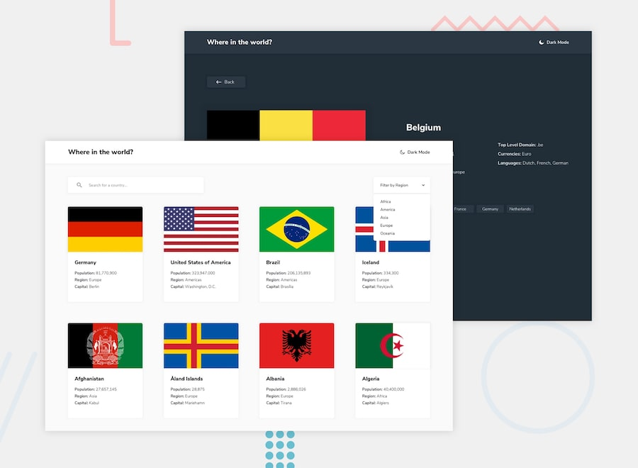

[Change to english](README.md)

# 🌍 Where in the world?

Uma aplicação web interativa que permite visualizar informações de todos os países do mundo, com suporte a tema escuro, navegação entre países vizinhos e busca com filtro por continente.



## 🔗 Acesse o projeto

👉 [witw-map.vercel.app](https://witw-map.vercel.app/)

## 🧰 Tecnologias utilizadas

- **React 19**
- **TypeScript**
- **Tailwind CSS v4**
- **Vite**
- **GSAP** (animações de entrada)
- **React Router 7**
- **REST Countries API**
- **Dark Mode**
- **Responsividade**

## ✨ Funcionalidades

- 🌐 Listagem de países com informações como nome, capital, região, população e bandeira
- 🔍 Filtro por continente e campo de busca (com debounce, os dois podem ser combinados)
- 📄 Paginação na página inicial (12 países por página)
- 🔗 Cada tela tem a sua própria URL, então dar F5 ou compartilhar o link mantém você onde estava:
  `/`, `/?q=bra&region=Americas&page=2`, `/country/BRA`
- 🌙 Alternância entre tema claro e escuro (salvo no `localStorage`)
- 📍 Detalhes do país com navegação entre países fronteiriços, e botões Back e Close (o Close volta para a mesma página/filtro da home)
- 📱 Design totalmente responsivo

## 📁 Estrutura do projeto

```
├── public/images/          # favicon e preview para redes sociais
├── design/                 # designs de referência do Frontend Mentor
├── src/
│   ├── api/                # requisições à REST Countries
│   ├── components/         # Header, SearchBar, RegionFilter, CountryCard, CountryGrid, CountryDetail...
│   ├── hooks/              # useTheme, useCountries, useCountriesContext, useCountryDetails
│   ├── lib/                # filtro, paginação, estado de rota e animações GSAP
│   ├── pages/              # HomePage (/) e CountryPage (/country/:code)
│   ├── types/              # tipos da API
│   ├── App.tsx
│   ├── index.css           # import do Tailwind + tokens do design (cores, sombras, breakpoints)
│   └── main.tsx
├── index.html
├── vercel.json             # redireciona todo caminho para o index.html (necessário para o F5 em links diretos)
├── vite.config.ts
└── package.json
```

## 🔑 Chave da API

A REST Countries antiga (v3.1), sem chave, foi desativada. Este projeto usa a **v5**, que exige uma chave gratuita:

1. Crie uma chave em [restcountries.com/sign-up](https://restcountries.com/sign-up).
2. Copie `.env.example` para `.env` e cole a chave em `VITE_RESTCOUNTRIES_API_KEY`.
3. Na Vercel, adicione a mesma variável em *Project Settings → Environment Variables*.

> O Vite embute as variáveis `VITE_*` no bundle, então a chave fica visível no navegador. Restrinja-a aos seus domínios
> (`localhost` e o domínio de produção) no painel da REST Countries e revogue-a se vazar.
> Sem chave, o app usa a `rc_live_demo`, que só retorna dados de exemplo.

## ⚙️ Como rodar o projeto localmente

1. Clone o repositório:

```bash
git clone https://github.com/jvssvj/where-in-the-world.git
cd where-in-the-world
```

2. Instale as dependências:

```bash
npm install
```

3. Rode o projeto em modo de desenvolvimento:

```bash
npm run dev
```

4. Para gerar o build de produção em `dist/`:

```bash
npm run build
```

🤝 Créditos
- REST Countries API
- Inspiração no [desafio do Frontend Mentor](https://www.frontendmentor.io/challenges/rest-countries-api-with-color-theme-switcher-5cacc469fec04111f7b848ca)
