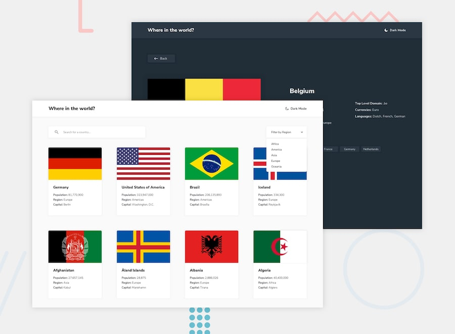

[Mudar para português](README.PTBR.md)

# 🌍 Where in the world?

An interactive web application that allows you to view information about all countries in the world. It supports dark mode, neighboring country navigation, and a search with continent filtering.



## 🔗 Live Demo

👉 [witw-map.vercel.app](https://witw-map.vercel.app/)

## 🧰 Technologies Used

- **React 19**
- **TypeScript**
- **Tailwind CSS v4**
- **Vite**
- **GSAP** (entrance animations)
- **React Router 7**
- **REST Countries API**
- **Dark Mode**
- **Responsive Design**

## ✨ Features

- 🌐 Country listing with information like name, capital, region, population, and flag
- 🔍 Filter by continent and search field (debounced, combinable)
- 📄 Pagination on the home page (12 countries per page)
- 🔗 Every screen has its own URL, so refreshing (F5) or sharing a link keeps you where you were:
  `/`, `/?q=bra&region=Americas&page=2`, `/country/BRA`
- 🌙 Toggle between light and dark themes (saved in `localStorage`)
- 📍 Country details with navigation through neighboring countries, plus Back and Close buttons (Close returns to the same page/filter of the home)
- 📱 Fully responsive layout

## 📁 Project Structure

```
├── public/images/          # favicon and social preview
├── design/                 # Frontend Mentor reference designs
├── src/
│   ├── api/                # REST Countries requests
│   ├── components/         # Header, SearchBar, RegionFilter, CountryCard, CountryGrid, CountryDetail...
│   ├── hooks/              # useTheme, useCountries, useCountriesContext, useCountryDetails
│   ├── lib/                # filtering, pagination, router state and GSAP animations
│   ├── pages/              # HomePage (/) and CountryPage (/country/:code)
│   ├── types/              # API types
│   ├── App.tsx
│   ├── index.css           # Tailwind import + design tokens (colors, shadows, breakpoints)
│   └── main.tsx
├── index.html
├── vercel.json             # rewrites every path to index.html (needed for F5 on deep links)
├── vite.config.ts
└── package.json
```

## 🔑 API key

The old key-free REST Countries (v3.1) was shut down. This project uses **v5**, which needs a free API key:

1. Create a key at [restcountries.com/sign-up](https://restcountries.com/sign-up).
2. Copy `.env.example` to `.env` and paste your key into `VITE_RESTCOUNTRIES_API_KEY`.
3. On Vercel, add the same variable under *Project Settings → Environment Variables*.

> Vite embeds `VITE_*` variables in the bundle, so the key is visible in the browser. Restrict it to your hostnames
> (`localhost` and your production domain) in the REST Countries dashboard and revoke it if it leaks.
> Without a key the app falls back to the `rc_live_demo` key, which only returns sample data.

## ⚙️ Running the Project Locally

1. Clone the repository:

```bash
git clone https://github.com/jvssvj/where-in-the-world.git
cd where-in-the-world
```

2. Install the dependencies:

```bash
npm install
```

3. Run the project in development mode:

```bash
npm run dev
```

4. To generate the production build in `dist/`:

```bash
npm run build
```

🤝 Credits
- REST Countries API
- Inspired by the [desafio do Frontend Mentor](https://www.frontendmentor.io/challenges/rest-countries-api-with-color-theme-switcher-5cacc469fec04111f7b848ca)
